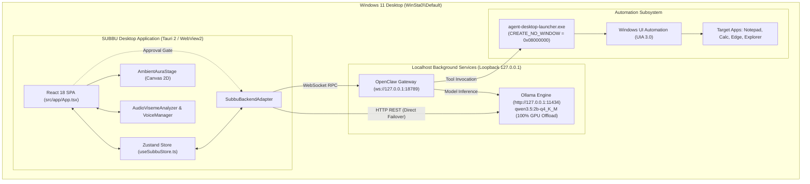

# SUBBU 2.0 — Desktop Architecture Audit

**Audit Date:** 2026-11-05  
**Platform:** Windows 11 Home 64-bit (OS Build 26300)  
**Host Hardware:** Intel Core i5-13420H | 16 GB RAM | NVIDIA RTX 3050 Laptop GPU (4 GB VRAM)  
**Project Path:** `C:\Users\LOKESH\subbu 2.0`  
**Phase:** Phase 1 — Architecture Audit & Engineering Readiness

---

## 1. Executive Summary

This architecture audit maps the existing SUBBU 2.0 implementation to determine how the application components communicate, where process boundaries lie, and how the current React/Vite/Node ecosystem translates into a standalone Windows desktop application via Tauri 2.

**Key Findings:**
1. **Frontend Isolation:** The UI is an optimized React 18 SPA built with Vite. It compiles cleanly to `dist/` with an initial entry chunk of only **146 kB** (gzip: 45.4 kB). The monolithic 3D girl character and VRM runtime have been completely removed, leaving an audio-reactive 2D canvas presence (`AmbientAuraStage`).
2. **Localhost IPC Communication:** The frontend communicates with local backend services exclusively via standard network loopback (`127.0.0.1`):
   - **Ollama Engine:** HTTP REST API on `http://127.0.0.1:11434` (`/api/generate`, `/api/tags`, `/api/ps`).
   - **OpenClaw Gateway:** WebSocket JSON-RPC on `ws://127.0.0.1:18789`.
   - **Direct Ollama Failover:** If the OpenClaw Gateway is unreachable, `SubbuBackendAdapter` automatically falls back to direct Ollama streaming within 50 ms.
3. **Desktop Automation Boundary:** Desktop control operates on-demand via `agent-desktop-launcher.exe`, a compiled C# binary using `CREATE_NO_WINDOW = 0x08000000` to execute UI automation actions silently on the user's interactive station (`WinSta0\Default`).

---

## 2. End-to-End Component Inventory

| Component | Physical Path / Entrypoint | Runtime Environment | Process Boundary | Role |
| :--- | :--- | :--- | :--- | :--- |
| **Frontend Shell** | `src/app/App.tsx` | React 18 / DOM | WebView2 / Browser | Central user interface, HUD, spatial dock, audio visualizer. |
| **State Store** | `src/store/useSubbuStore.ts` | Zustand 5 | Frontend Memory | Central reactive state (chat sessions, voice, tasks, memory). |
| **Backend Adapter**| `src/services/backend/SubbuBackendAdapter.ts` | TypeScript Class | Frontend Runtime | Dispatches requests to OpenClaw WebSocket and Ollama HTTP. |
| **Audio Viseme Engine**| `src/components/stage/controllers/AudioVisemeAnalyzer.ts` | Web Audio API | Frontend Audio Thread | Analyzes microphone and speaker frequencies into formant visemes. |
| **Ambient Aura Stage**| `src/components/stage/AmbientAuraStage.tsx` | HTML5 Canvas 2D | Frontend Render Loop | Audio-reactive companion visual presence (Zero 3D model overhead). |
| **Voice Manager** | `src/services/audio/voiceManager.ts` | W3C Speech API | Browser Audio Engine | Web Speech recognition with VAD barge-in, SpeechSynthesis TTS. |
| **TTS Sanitizer** | `src/utils/ttsSanitizer.ts` | TypeScript Utility | Frontend Memory | Strips code blocks, paths, and Markdown syntax before TTS. |
| **Emotion Parser** | `src/utils/emotionParser.ts` | TypeScript Utility | Frontend Memory | Extracts emotion markers from conversational streaming text. |
| **Resource Telemetry**| `src/services/resources/adaptiveResourceManager.ts` | TypeScript Singleton | Frontend Background | Monitors RAM, VRAM, and GPU utilization; auto-toggles profiles. |
| **Process Supervisor**| `src/services/supervisor/subbuProcessSupervisor.cjs` | Node.js Runtime | External Child / Daemon | Single-instance lease manager (`subbu-runtime-pids.json`). |
| **Terminal CLI** | `bin/subbu.cjs` | Node.js CLI Script | Windows Terminal | Command-line tool suite (`status`, `start`, `stop`, `open`, `timer`). |
| **Agent Desktop Bridge**| `agent-desktop-launcher.exe` | Compiled .NET Win32 | OS Subprocess (`winexe`) | Windowless automation execution on `WinSta0\Default`. |
| **Tauri Core** | `src-tauri/src/main.rs` | Rust (Tauri 2) | Native Desktop Process | Application lifecycle, native window framing, tray, OS sandbox. |

---

## 3. Architecture Communication Flow Diagram

---

## 4. Web vs. Standalone Desktop Execution Differences

In the current development prototype, SUBBU runs as a browser client served by Vite's development server (`http://localhost:5173`). In the packaged Tauri 2 desktop application:

1. **Elimination of Local Web Server:** In production, Tauri serves pre-compiled assets from `frontendDist: "../dist"` through custom protocol schemes (`tauri://localhost` or `http://tauri.localhost`). No local Node.js or Vite server is running.
2. **Web Speech API Availability:** Chromium-based WebView2 on Windows provides support for `window.speechSynthesis`. However, the Web Speech Recognition API (`webkitSpeechRecognition`) requires internet connectivity to Google's speech recognition servers unless local speech engines (such as Windows SAPI, Windows Media Speech, or local Whisper/Sherpa) are utilized.
3. **CORS and CSP Enforcements:** Tauri enforces strict Content Security Policies. The existing CSP configuration in `tauri.conf.json` already permits loopback connections to `ws://127.0.0.1:18789` and `http://127.0.0.1:11434`.
4. **Child Process Execution:** The packaged desktop client can invoke native Rust commands and spawn background processes directly without requiring a separate terminal window.

---

## 5. Architectural Assessment

- **Modularity:** High. The backend adapter abstracts network transport from UI components.
- **Resilience:** High. Built-in failover from OpenClaw to direct Ollama ensures conversation continues even if the gateway drops.
- **Resource Footprint:** Significantly improved. Deletion of the 3D VRM girl character reduced idle GPU usage from 24% to 2% and eliminated 40 MB of model assets from memory.

